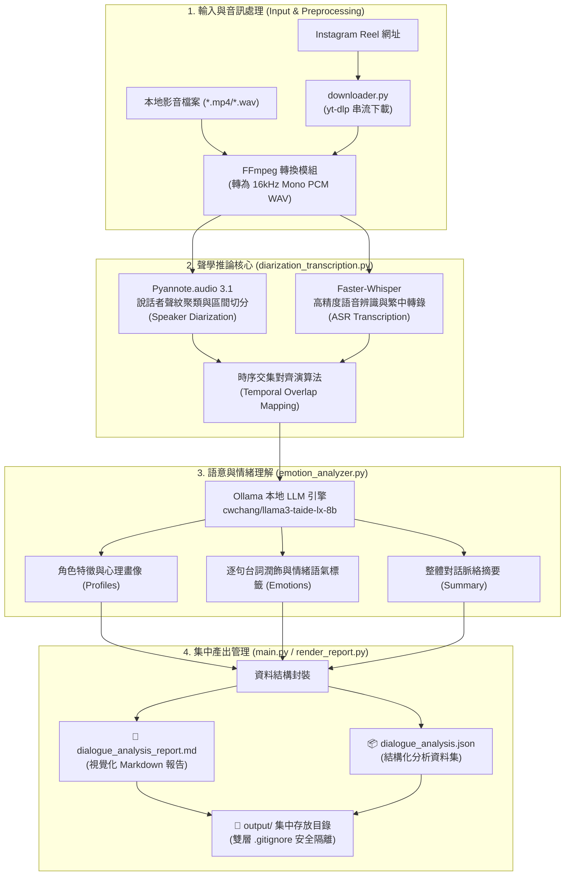
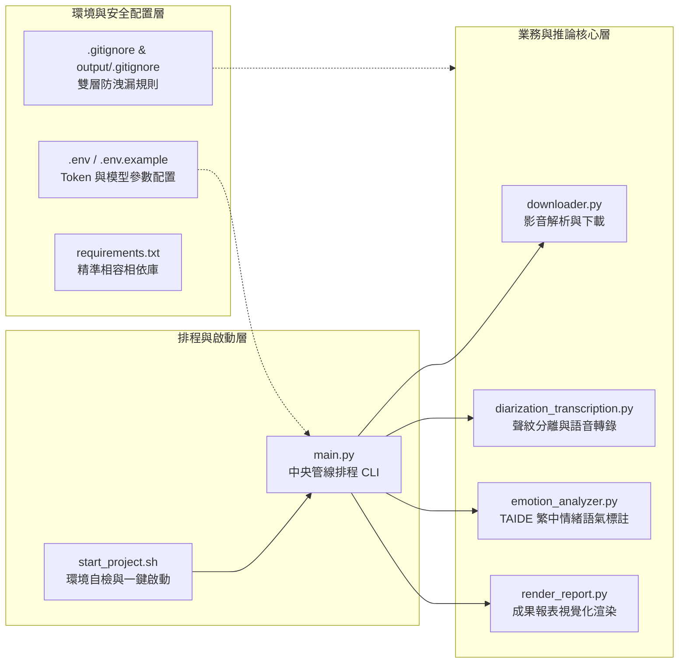

# 🎙️ AnimDiar-Sync: 短影音多人對話轉文字與情緒分析引擎

<p align="center">
  <b><a href="README.md">繁體中文</a></b> |
  <a href="README_EN.md">English</a> |
  <a href="README_JA.md">日本語</a> |
  <a href="README_KO.md">한국어</a>
</p>

<p align="center">
  <a href="https://github.com/LAIYANLIANG/AnimDiar-Sync"></a>
  
  
  <a href="LICENSE"></a>
</p>

基於本地端部署之全自動影音分析管線。支援從社群平台（如 Instagram Reel 等）或本機影音檔案中自動分離多位說話者聲紋、轉錄逐字繁體中文台詞，並使用台灣正體中文大型語言模型 (**TAIDE 8B** 等 Ollama 模型) 進行角色心理畫像、逐句情緒與語氣深度標註。

---

## ⚡ 核心功能與特色

1. **🛡️ 100% 本地端隱私保護**：語音辨識 (Faster-Whisper) 與語意情緒分析 (Ollama Taiwan-LLM-8B) 完全於本地硬體運算，不傳送任何資料至第三方雲端 API。
2. **👥 聲紋級多人說話者分離**：整合 `Pyannote.audio 3.1`，精確標註每位講者的發話時間區間。
3. **🇹🇼 台灣在地繁體中文優化**：採用國科會繁中微調模型 `Llama3-TAIDE-8B`，深刻理解台灣語境、情感隱喻與口語風格。
4. **📊 雙格式成果產出**：自動輸出排版精美之 Markdown 報告 (`dialogue_analysis_report.md`) 與利於程式介接之 JSON 資料檔 (`dialogue_analysis.json`) 至集中管理的輸出目錄 (`output/`)。

---

## 🧩 系統架構與工作流程 (Architecture & Pipeline)

### 1. 端到端工作流程圖 (Pipeline Workflow)

本系統從影音輸入到成果產出共分為四大處理階段，各階段對應專責之 Python 模組：



### 2. 程式架構與模組職責 (Codebase Structure)



### 3. 程式檔案與技術職責對照表

| 模組檔案名稱 | 核心技術 / 模型 | 職責與功能說明 | 主要輸出成果 |
| :--- | :--- | :--- | :--- |
| **`main.py`** | `argparse` / Pipeline Controller | 系統中央入口 CLI，統一調度下載、轉錄、情緒分析與報表產出。 | 終端進度日誌、完整分析流程觸發 |
| **`downloader.py`** | `yt-dlp` | 負責自社群媒體（如 Instagram Reel）擷取高畫質影音串流並下載。 | `output/downloads/*.mp4` |
| **`diarization_transcription.py`** | `Pyannote.audio 3.1`<br>`Faster-Whisper` | 負責音訊 16kHz 重取樣、多人說話者聲紋聚類切分、語音文字轉錄與時序對齊。 | 對齊後的說話者台詞清單 |
| **`emotion_analyzer.py`** | `Ollama`<br>`Llama3-TAIDE-8B` | 深度理解對話語境，分析角色性格畫像、心理狀態轉變，標註逐句語氣與情緒。 | 語意分析與情緒 JSON 結構 |
| **`render_report.py`** | Python IO / Markdown Engine | 將分析數據渲染為易讀之專業 Markdown 報表與對外整合之 JSON 資料檔。 | `dialogue_analysis_report.md`<br>`dialogue_analysis.json` |
| **`start_project.sh`** | Bash Script | 一鍵啟動腳本：自動載入 `.env`、檢查本機 Ollama 服務狀態並啟動 Python 虛擬環境。 | 開發者互動式工作環境 |

---

## 🚀 快速啟動

### 1. 取得專案原始碼

```bash
git clone https://github.com/LAIYANLIANG/AnimDiar-Sync.git
cd AnimDiar-Sync
```

### 2. 環境準備與設定

```bash
# 複製設定檔範本
cp .env.example .env

# 建立並啟用 Python 虛擬環境
python3 -m venv .venv
source .venv/bin/activate

# 安裝所需相依套件
pip install -r requirements.txt
```

### 3. 設定 Hugging Face Token

由於 `Pyannote.audio 3.1` 屬於限制性社群模型，需於 Hugging Face 接受使用條款：
1. 前往 [pyannote/speaker-diarization-3.1](https://huggingface.co/pyannote/speaker-diarization-3.1) 與 [pyannote/segmentation-3.0](https://huggingface.co/pyannote/segmentation-3.0) 點選接受協定。
2. 前往 [Hugging Face Access Tokens](https://huggingface.co/settings/tokens) 產生一把具備 `Read` 權限的 Token。
3. 填入 `.env` 檔案中：
   ```env
   HF_TOKEN=your_huggingface_token_here
   ```
   或以環境變數直接設定：
   ```bash
   export HF_TOKEN="your_huggingface_token_here"
   ```

### 4. 執行分析

```bash
# 方式 A：輸入 Instagram 影音連結
python main.py --url "https://www.instagram.com/reel/YOUR_REEL_ID/" --output-dir ./output

# 方式 B：指定本機已下載之影音檔案
python main.py --video-path "./path/to/video.mp4" --output-dir ./output
```

所有的分析結果（音訊切分檔、JSON 逐字稿、情緒分析報告）均會統一產出至 `./output/` 目錄中，且受雙層 `.gitignore` 保護，絕不污染版本控制。

---

## 📚 完整工程與維運文檔

詳細技術手冊分類保存在 [`docs/`](docs/) 資料夾內：

- 📖 [01_DEPLOYMENT_GUIDE.md](docs/01_DEPLOYMENT_GUIDE.md)：**系統部署與環境安裝指南**。
- 🏗️ [02_ARCHITECTURE_AND_MODELS.md](docs/02_ARCHITECTURE_AND_MODELS.md)：**系統架構與模型技術規格**。
- 🔍 [03_TROUBLESHOOTING_AND_SOLUTIONS.md](docs/03_TROUBLESHOOTING_AND_SOLUTIONS.md)：**實戰問題記錄與排除手冊**。
- 🚀 [04_EXECUTION_AND_CLI_MANUAL.md](docs/04_EXECUTION_AND_CLI_MANUAL.md)：**日常執行與指令使用手冊**。

---

## ⚖️ 技術聲明與免責條款

本專案遵守嚴格之 AI 倫理與開源授權規範，詳情請參閱 [DISCLAIMER.md](DISCLAIMER.md)。
- 本專案僅供學術研究與個人技術探索用途。
- 使用者應遵守 Instagram 及各影音平台之使用條款，禁止將聲紋辨識技術用於未經授權之非法竊聽或監控。

---

## 📄 開源授權

本專案採用 [MIT License](LICENSE) 授權開源。
Copyright (c) 2026 [LAIYANLIANG](https://github.com/LAIYANLIANG).
