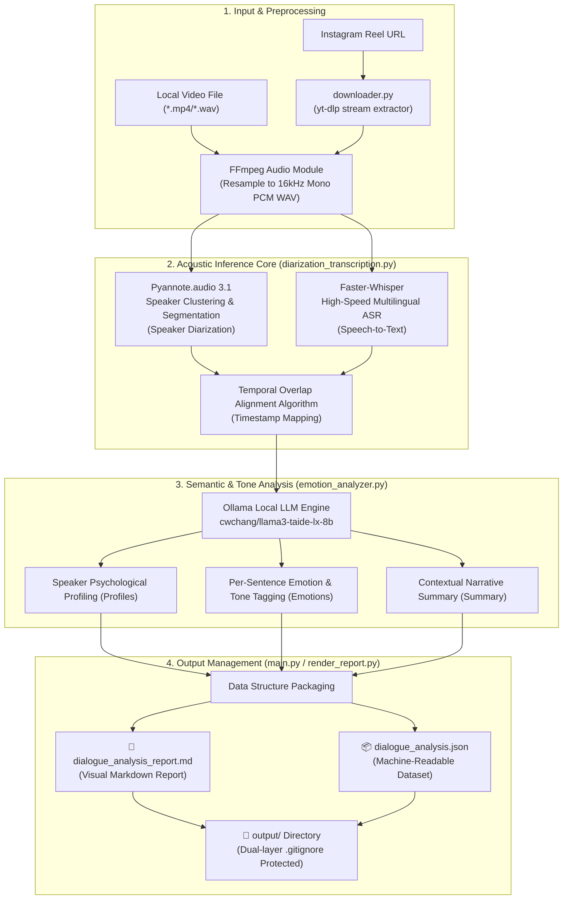
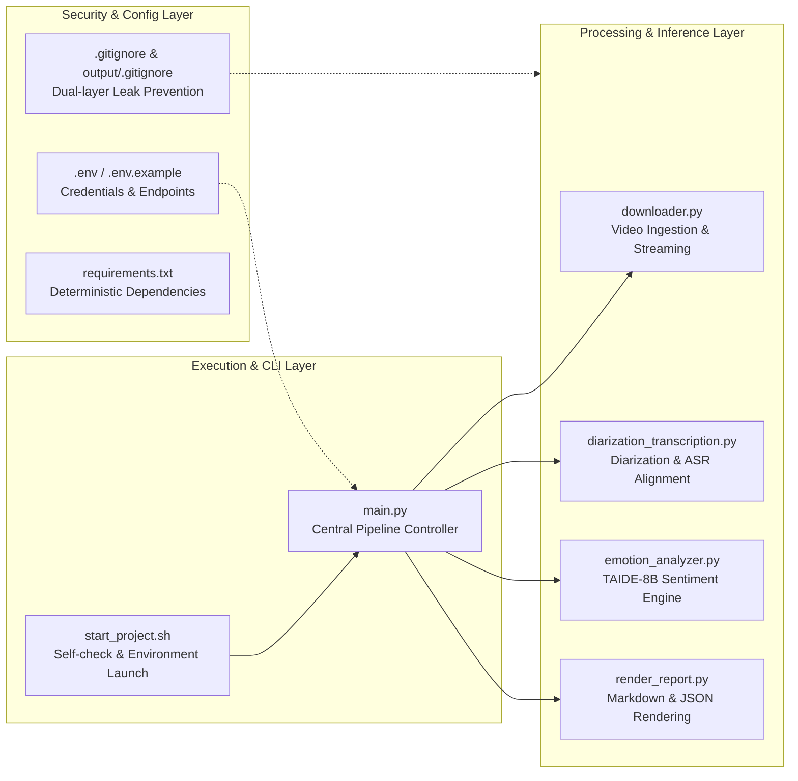

# 🎙️ AnimDiar-Sync: Multi-Speaker Diarization, Transcription & Sentiment Analysis Engine

<p align="center">
  <a href="README.md">繁體中文</a> |
  <b><a href="README_EN.md">English</a></b> |
  <a href="README_JA.md">日本語</a> |
  <a href="README_KO.md">한국어</a>
</p>

<p align="center">
  <a href="https://github.com/LAIYANLIANG/AnimDiar-Sync"></a>
  
  
  <a href="LICENSE"></a>
</p>

An automated, privacy-first offline video-to-speech intelligence pipeline. Designed to extract and isolate multiple speaker voiceprints from social media videos (such as Instagram Reels) or local video files, perform fast and precise automatic speech recognition (ASR via **Faster-Whisper**), and leverage localized LLMs (such as **Llama3-TAIDE-8B** via Ollama) to build speaker behavioral profiles and granular sentence-level emotional / tonal annotations.

---

## ⚡ Key Features

1. **🛡️ 100% On-Device Privacy**: Speech recognition (Faster-Whisper) and sentiment analysis (Ollama Local LLM) execute completely offline on local hardware—zero audio or transcript data is transmitted to cloud APIs.
2. **👥 High-Precision Speaker Diarization**: Powered by `Pyannote.audio 3.1`, segmenting dialogues with exact timestamps for each distinct voiceprint.
3. **🇹🇼 Localized Nuance & Tone Understanding**: Integrated with Taiwan-focused LLMs (e.g., `Llama3-TAIDE-8B`) to understand subtle emotional cues, humor, sarcasm, and cultural context.
4. **📊 Dual Structured Deliverables**: Automatically renders formatted Markdown executive reports (`dialogue_analysis_report.md`) alongside structured JSON datasets (`dialogue_analysis.json`) into an isolated `output/` directory protected by multi-layer Git security.

---

## 🧩 System Architecture & Pipeline Workflow

### 1. End-to-End Pipeline Workflow

The pipeline operates across four discrete stages, each executed by a modularized component:



### 2. Codebase Architecture



### 3. Module Responsibilities Matrix

| Module | Core Technology | Role & Functionality | Key Output |
| :--- | :--- | :--- | :--- |
| **`main.py`** | `argparse` / Pipeline Controller | CLI orchestrator executing the ingestion, diarization, transcription, and analysis workflow. | Terminal progress logs, triggers complete pipeline |
| **`downloader.py`** | `yt-dlp` | Handles video stream retrieval from social platforms (e.g., Instagram Reels). | `output/downloads/*.mp4` |
| **`diarization_transcription.py`** | `Pyannote.audio 3.1`<br>`Faster-Whisper` | Audio resampling, speaker voiceprint clustering, speech recognition, and timestamp alignment. | Aligned speaker dialogue transcript |
| **`emotion_analyzer.py`** | `Ollama`<br>`Llama3-TAIDE-8B` | Natural language contextual analysis, psychological profiling, emotion and conversational tone tagging. | Semantic emotion JSON structure |
| **`render_report.py`** | Python IO / Markdown Engine | Transforms structured data into comprehensive Markdown documents and JSON records. | `dialogue_analysis_report.md`<br>`dialogue_analysis.json` |
| **`start_project.sh`** | Bash Script | One-click developer entrypoint: verifies Ollama daemon, exports environment variables, activates `.venv`. | Interactive work environment |

---

## 🚀 Quick Start

### 1. Clone the Repository

```bash
git clone https://github.com/LAIYANLIANG/AnimDiar-Sync.git
cd AnimDiar-Sync
```

### 2. Environment Setup

```bash
# Copy environment configuration template
cp .env.example .env

# Create and activate Python virtual environment
python3 -m venv .venv
source .venv/bin/activate

# Install dependencies
pip install -r requirements.txt
```

### 3. Configure Hugging Face Token

`Pyannote.audio 3.1` is a gated community model. You must accept its user terms on Hugging Face:
1. Visit [pyannote/speaker-diarization-3.1](https://huggingface.co/pyannote/speaker-diarization-3.1) and [pyannote/segmentation-3.0](https://huggingface.co/pyannote/segmentation-3.0) and accept the terms of use.
2. Generate a token with `Read` permission at [Hugging Face Access Tokens](https://huggingface.co/settings/tokens).
3. Set your token in `.env`:
   ```env
   HF_TOKEN=your_huggingface_token_here
   ```
   Or export it in your shell:
   ```bash
   export HF_TOKEN="your_huggingface_token_here"
   ```

### 4. Run Analysis

```bash
# Option A: Analyze an Instagram Reel directly by URL
python main.py --url "https://www.instagram.com/reel/YOUR_REEL_ID/" --output-dir ./output

# Option B: Analyze a local video file
python main.py --video-path "./path/to/video.mp4" --output-dir ./output
```

All generated files (extracted 16kHz WAV, timestamped JSON dialogues, and executive Markdown reports) are saved to `./output/`.

---

## 📚 Technical Documentation

Comprehensive operational and engineering guides are available in [`docs/`](docs/):

- 📖 [01_DEPLOYMENT_GUIDE.md](docs/01_DEPLOYMENT_GUIDE.md): **System deployment and environment setup instructions**.
- 🏗️ [02_ARCHITECTURE_AND_MODELS.md](docs/02_ARCHITECTURE_AND_MODELS.md): **System architecture & model specifications**.
- 🔍 [03_TROUBLESHOOTING_AND_SOLUTIONS.md](docs/03_TROUBLESHOOTING_AND_SOLUTIONS.md): **Troubleshooting and conflict resolution guide**.
- 🚀 [04_EXECUTION_AND_CLI_MANUAL.md](docs/04_EXECUTION_AND_CLI_MANUAL.md): **CLI reference and operational manual**.

---

## ⚖️ Technical Disclaimer & Ethical AI Statement

This project adheres strictly to AI safety and open-source compliance standards. Please review [DISCLAIMER.md](DISCLAIMER.md) before deployment.
- Intended solely for academic research, education, and authorized media analysis.
- Users must comply with applicable platform Terms of Service. Unlawful acoustic surveillance or biometric profiling without consent is strictly prohibited.

---

## 📄 License

Licensed under the [MIT License](LICENSE).
Copyright (c) 2026 [LAIYANLIANG](https://github.com/LAIYANLIANG).
