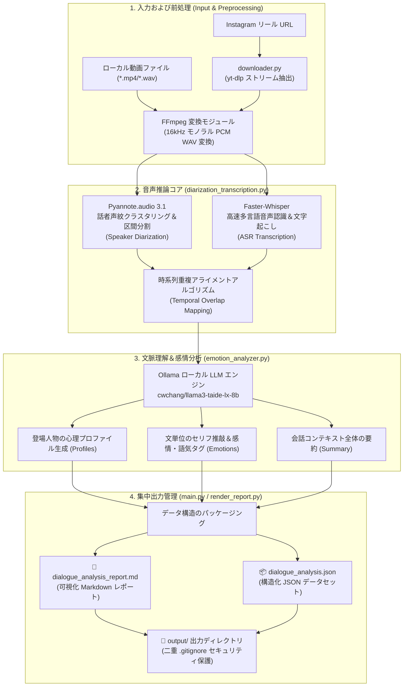
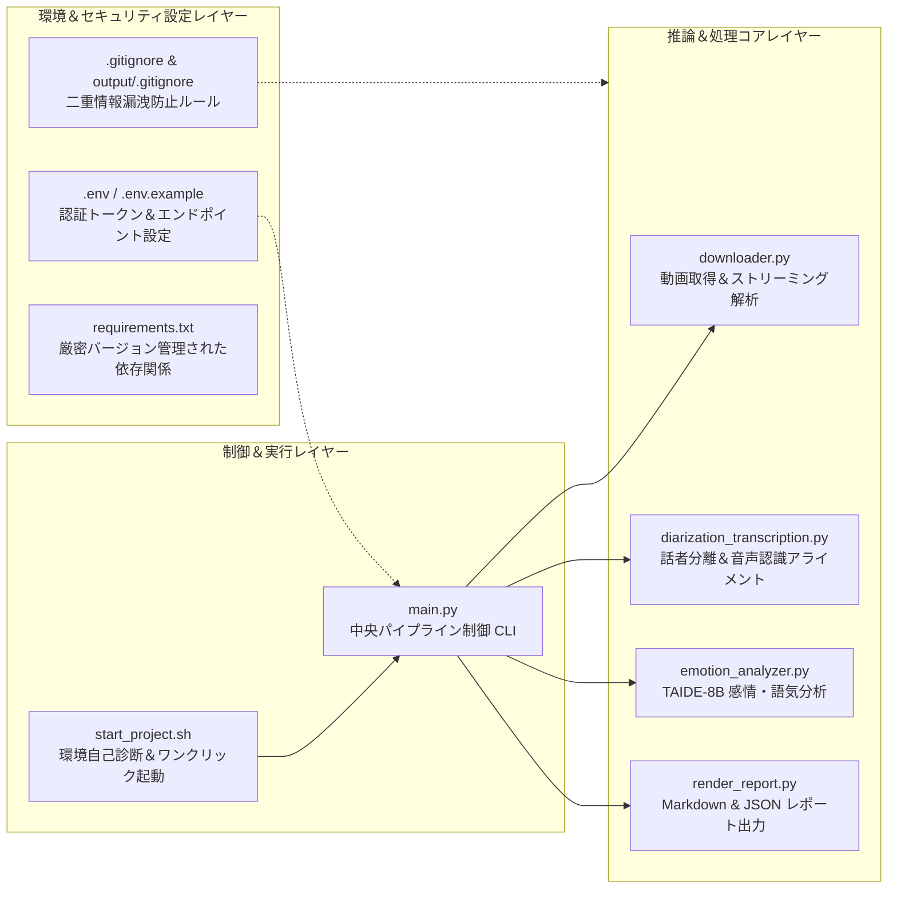

# 🎙️ AnimDiar-Sync: ショート動画複数話者分離・文字起こし＆感情分析エンジン

<p align="center">
  <a href="README.md">繁體中文</a> |
  <a href="README_EN.md">English</a> |
  <b><a href="README_JA.md">日本語</a></b> |
  <a href="README_KO.md">한국어</a>
</p>

<p align="center">
  <a href="https://github.com/LAIYANLIANG/AnimDiar-Sync"></a>
  
  
  <a href="LICENSE"></a>
</p>

プライバシー完全保護型のローカル完結型動画・音声インテリジェンス処理パイプライン。Instagram リールやローカル動画から複数の話者の声紋を自動分離し、高精度な音声認識（**Faster-Whisper**）を実行、さらにローカル LLM（Ollama 上の **TAIDE 8B** 等）を用いて発話者ごとの心理プロファイル構築および文単位の感情・語気アノテーションを自動生成します。

---

## ⚡ 主な特徴と機能

1. **🛡️ 100% ローカル完結のプライバシー保護**：音声認識（Faster-Whisper）および感情分析（Ollama Local LLM）はすべてローカルハードウェア上で推論され、外部クラウド API へデータが送信されることは一切ありません。
2. **👥 高精度な話者分離（Diarization）**：`Pyannote.audio 3.1` を統合し、各話者の発話時間帯をミリ秒単位で正確にセグメンテーション。
3. **🇹🇼 ニュアンス・感情表現の精密解析**：台湾華語・繁体字に特化した `Llama3-TAIDE-8B` を活用し、文脈に潜む感情の機微やユーモア、口語的ニュアンスを深く理解。
4. **📊 2種類の構造化レポート出力**：見やすい Markdown 形式の分析レポート (`dialogue_analysis_report.md`) とプログラム連携に適した JSON データ (`dialogue_analysis.json`) を、二重 Git 保護された集中出力ディレクトリ (`output/`) へ自動出力。

---

## 🧩 システム設計とワークフロー (Architecture & Pipeline)

### 1. エンドツーエンド処理フロー (Pipeline Workflow)

本パイプラインは4つの処理フェーズで構成され、それぞれ独立した Python モジュールによって実行されます：



### 2. プログラム構造とモジュール構成 (Codebase Architecture)



### 3. モジュール機能対応表

| モジュール名 | コア技術 / モデル | 役割と主な機能 | 主な出力 |
| :--- | :--- | :--- | :--- |
| **`main.py`** | `argparse` / Pipeline Controller | CLI コントローラー。ダウンロード、話者分離、文字起こし、感情分析、レポート生成の全工程を統括。 | コンソール進捗ログ、処理の実行トリガー |
| **`downloader.py`** | `yt-dlp` | Instagram リール等の SNS から高画質な動画・音声を自動抽出・ダウンロード。 | `output/downloads/*.mp4` |
| **`diarization_transcription.py`** | `Pyannote.audio 3.1`<br>`Faster-Whisper` | 16kHz リサンプリング、話者声紋クラスタリング、高速文字起こし、タイムスタンプのアライメント。 | 話者タグ付きセリフリスト |
| **`emotion_analyzer.py`** | `Ollama`<br>`Llama3-TAIDE-8B` | 会話全体の文脈把握、話者心理プロファイル作成、各セリフの感情・語気アノテーション。 | 感情分析 JSON データ構造 |
| **`render_report.py`** | Python IO / Markdown Engine | 分析データを整形し、見やすい Markdown 文書およびシステム連携用 JSON へ出力。 | `dialogue_analysis_report.md`<br>`dialogue_analysis.json` |
| **`start_project.sh`** | Bash Script | ワンクリック起動スクリプト。`.env` 読み込み、Ollama サービス状態確認、`.venv` 有効化を自動実行。 | 対話型作業シェル環境 |

---

## 🚀 クイックスタート

### 1. リポジトリのクローン

```bash
git clone https://github.com/LAIYANLIANG/AnimDiar-Sync.git
cd AnimDiar-Sync
```

### 2. 環境設定

```bash
# 環境設定テンプレートをコピー
cp .env.example .env

# Python 仮想環境の作成と有効化
python3 -m venv .venv
source .venv/bin/activate

# 依存パッケージのインストール
pip install -r requirements.txt
```

### 3. Hugging Face トークンの設定

`Pyannote.audio 3.1` は利用許諾が必要なコミュニティモデルです：
1. [pyannote/speaker-diarization-3.1](https://huggingface.co/pyannote/speaker-diarization-3.1) および [pyannote/segmentation-3.0](https://huggingface.co/pyannote/segmentation-3.0) にアクセスし利用規約に同意してください。
2. [Hugging Face Access Tokens](https://huggingface.co/settings/tokens) で `Read` 権限のトークンを作成します。
3. `.env` ファイルに設定します：
   ```env
   HF_TOKEN=your_huggingface_token_here
   ```
   または環境変数で指定：
   ```bash
   export HF_TOKEN="your_huggingface_token_here"
   ```

### 4. 分析の実行

```bash
# 方法 A: Instagram リールの URL を直接指定
python main.py --url "https://www.instagram.com/reel/YOUR_REEL_ID/" --output-dir ./output

# 方法 B: ローカルの動画ファイルを指定
python main.py --video-path "./path/to/video.mp4" --output-dir ./output
```

すべての解析結果（抽出音声 WAV、タイムスタンプ付き対話 JSON、Markdown レポート）は `./output/` に出力されます。

---

## 📚 ドキュメント

詳細な技術解説・トラブルシューティングは [`docs/`](docs/) に保管されています：

- 📖 [01_DEPLOYMENT_GUIDE.md](docs/01_DEPLOYMENT_GUIDE.md)：**システム構築と環境セットアップ手順**
- 🏗️ [02_ARCHITECTURE_AND_MODELS.md](docs/02_ARCHITECTURE_AND_MODELS.md)：**アーキテクチャ設計とモデル技術仕様**
- 🔍 [03_TROUBLESHOOTING_AND_SOLUTIONS.md](docs/03_TROUBLESHOOTING_AND_SOLUTIONS.md)：**障害対応とトラブルシューティング事例**
- 🚀 [04_EXECUTION_AND_CLI_MANUAL.md](docs/04_EXECUTION_AND_CLI_MANUAL.md)：**CLI 操作マニュアルとコマンドリファレンス**

---

## ⚖️ 免責事項と AI 倫理声明

本プロジェクトは AI 倫理およびオープンソースコンプライアンスを厳格に遵守します。詳細は [DISCLAIMER.md](DISCLAIMER.md) をご確認ください。
- 本ツールは学術研究および正規許諾を得たメディア分析のみを目的としています。
- プラットフォーム利用規約を遵守し、本人の同意のない不法な盗聴や音響監視用途への利用を固く禁止します。

---

## 📄 ライセンス

本プロジェクトは [MIT License](LICENSE) のもとで公開されています。
Copyright (c) 2026 [LAIYANLIANG](https://github.com/LAIYANLIANG).
