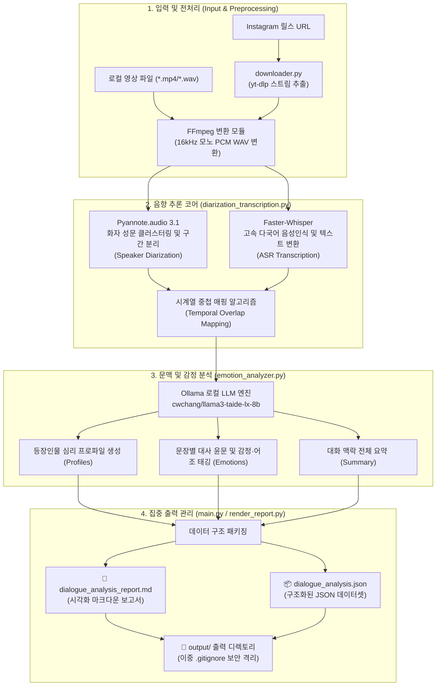
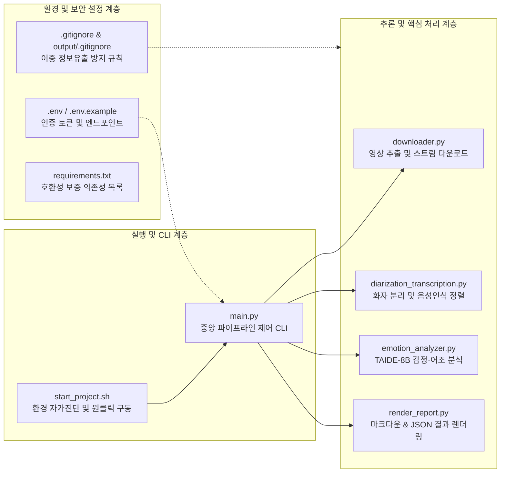

# 🎙️ AnimDiar-Sync: 숏폼 영상 다중 화자 분리, 텍스트 변환 및 감정 분석 엔진

<p align="center">
  <a href="README.md">繁體中文</a> |
  <a href="README_EN.md">English</a> |
  <a href="README_JA.md">日本語</a> |
  <b><a href="README_KO.md">한국어</a></b>
</p>

<p align="center">
  <a href="https://github.com/LAIYANLIANG/AnimDiar-Sync"></a>
  
  
  <a href="LICENSE"></a>
</p>

개인정보를 100% 보호하는 온디바이스(On-Device) 로컬 완결형 음성·영상 지능 분석 파이프라인입니다. 인스타그램 릴스(Instagram Reels) 또는 로컬 영상 파일에서 여러 화자의 성문을 자동으로 분리하고, **Faster-Whisper**를 통한 고정밀 음성 인식(STT)과 로컬 LLM(**TAIDE 8B** 등)을 활용하여 등장인물의 심리 프로파일 및 문장 단위 감정·어조 분석 보고서를 생성합니다.

---

## ⚡ 핵심 기능 및 특징

1. **🛡️ 100% 온디바이스 프라이버시 보호**: 음성 인식(Faster-Whisper) 및 감정 분석(Ollama Local LLM)이 전적으로 로컬 하드웨어에서 처리되어 외부 클라우드 API로 데이터가 전송되지 않습니다.
2. **👥 정밀 다중 화자 분리(Diarization)**: `Pyannote.audio 3.1`을 탑재하여 각 화자의 발화 구간을 밀리초 단위로 정확히 분리합니다.
3. **🇹🇼 문맥 및 감정 뉘앙스 정밀 해석**: 대만 번체 맞춤형 모델인 `Llama3-TAIDE-8B`를 통합하여 대화 속 미묘한 감정선, 비유, 유머 및 구어적 표현을 깊이 있게 이해합니다.
4. **📊 구조화된 2중 출력 포맷**: 가독성 높은 마크다운 보고서(`dialogue_analysis_report.md`)와 연동용 JSON 데이터(`dialogue_analysis.json`)를 이중 Git 보안이 적용된 집중 출력 폴더(`output/`)에 자동 저장합니다.

---

## 🧩 시스템 아키텍처 및 작업 파이프라인 (Architecture & Pipeline)

### 1. 엔드투엔드 파이프라인 워크플로우 (Pipeline Workflow)

본 파이프라인은 4개의 독립된 단계로 동작하며, 각각 전담 모듈에 의해 실행됩니다:



### 2. 코드베이스 아키텍처 (Codebase Structure)



### 3. 모듈별 역할 및 기술 스펙

| 모듈 파일명 | 핵심 기술 / 모델 | 주요 역할 및 기능 설명 | 산출물 |
| :--- | :--- | :--- | :--- |
| **`main.py`** | `argparse` / Pipeline Controller | CLI 컨트롤러. 다운로드, 화자 분리, STT, 감정 분석, 보고서 생성을 총괄 제어. | 콘솔 진행 로그, 전체 프로세스 트리거 |
| **`downloader.py`** | `yt-dlp` | 인스타그램 릴스 등 SNS 플랫폼에서 고화질 영상/오디오 스트림을 안전하게 추출. | `output/downloads/*.mp4` |
| **`diarization_transcription.py`** | `Pyannote.audio 3.1`<br>`Faster-Whisper` | 오디오 16kHz 리샘플링, 화자 성문 클러스터링 분리, 텍스트 변환 및 타임스탬프 정렬. | 화자 태그가 매핑된 대사 목록 |
| **`emotion_analyzer.py`** | `Ollama`<br>`Llama3-TAIDE-8B` | 대화 맥락 심층 이해, 인물 성격 프로파일링, 각 문장별 감정선 및 심리 어조 태깅. | 감정 분석 JSON 데이터 구조 |
| **`render_report.py`** | Python IO / Markdown Engine | 분석 데이터를 가독성 높은 마크다운 보고서 및 시스템 연동용 JSON 파일로 변환. | `dialogue_analysis_report.md`<br>`dialogue_analysis.json` |
| **`start_project.sh`** | Bash Script | 원클릭 실행 스크립트. `.env` 로드, Ollama 서버 확인, `.venv` 가상환경 활성화를 자동 수행. | 대화형 작업 셸 환경 |

---

## 🚀 빠른 시작 (Quick Start)

### 1. 저장소 복제 (Clone)

```bash
git clone https://github.com/LAIYANLIANG/AnimDiar-Sync.git
cd AnimDiar-Sync
```

### 2. 환경 설정

```bash
# 환경 설정 템플릿 복사
cp .env.example .env

# Python 가상환경 생성 및 활성화
python3 -m venv .venv
source .venv/bin/activate

# 필수 패키지 설치
pip install -r requirements.txt
```

### 3. Hugging Face 토큰 설정

`Pyannote.audio 3.1`은 라이선스 동의가 필요한 커뮤니티 모델입니다:
1. [pyannote/speaker-diarization-3.1](https://huggingface.co/pyannote/speaker-diarization-3.1) 및 [pyannote/segmentation-3.0](https://huggingface.co/pyannote/segmentation-3.0) 페이지에 방문하여 이용 약관에 동의합니다.
2. [Hugging Face Access Tokens](https://huggingface.co/settings/tokens)에서 `Read` 권한의 토큰을 발급받습니다.
3. `.env` 파일에 토큰을 입력합니다:
   ```env
   HF_TOKEN=your_huggingface_token_here
   ```
   또는 터미널 환경변수로 직접 지정:
   ```bash
   export HF_TOKEN="your_huggingface_token_here"
   ```

### 4. 분석 실행

```bash
# 방법 A: Instagram Reels URL 직접 분석
python main.py --url "https://www.instagram.com/reel/YOUR_REEL_ID/" --output-dir ./output

# 방법 B: 로컬 영상 파일 분석
python main.py --video-path "./path/to/video.mp4" --output-dir ./output
```

모든 분석 결과물(추출된 16kHz WAV, 타임스탬프 대화 JSON, 마크다운 보고서)은 `./output/` 폴더에 저장됩니다.

---

## 📚 엔지니어링 문서

상세 아키텍처 및 트러블슈팅 가이드는 [`docs/`](docs/) 폴더에서 확인하실 수 있습니다:

- 📖 [01_DEPLOYMENT_GUIDE.md](docs/01_DEPLOYMENT_GUIDE.md): **시스템 배포 및 환경 설정 가이드**
- 🏗️ [02_ARCHITECTURE_AND_MODELS.md](docs/02_ARCHITECTURE_AND_MODELS.md): **시스템 아키텍처 및 모델 기술 사양서**
- 🔍 [03_TROUBLESHOOTING_AND_SOLUTIONS.md](docs/03_TROUBLESHOOTING_AND_SOLUTIONS.md): **실전 이슈 해결 및 트러블슈팅 매뉴얼**
- 🚀 [04_EXECUTION_AND_CLI_MANUAL.md](docs/04_EXECUTION_AND_CLI_MANUAL.md): **CLI 명령어 및 실행 매뉴얼**

---

## ⚖️ 기술 및 AI 윤리 면책 성명

본 프로젝트는 AI 윤리 및 오픈소스 컴플라이언스를 준수합니다. 자세한 내용은 [DISCLAIMER.md](DISCLAIMER.md)를 참고하십시오.
- 본 도구는 학술 연구 및 정당한 권한이 있는 미디어 분석 목적으로만 제공됩니다.
- 각 플랫폼의 이용 약관을 준수해야 하며, 화자의 동의 없는 불법 도청 또는 음향 감시 목적으로의 사용을 엄격히 금지합니다.

---

## 📄 라이선스

본 프로젝트는 [MIT License](LICENSE)에 따라 오픈소스로 배포됩니다.
Copyright (c) 2026 [LAIYANLIANG](https://github.com/LAIYANLIANG).
